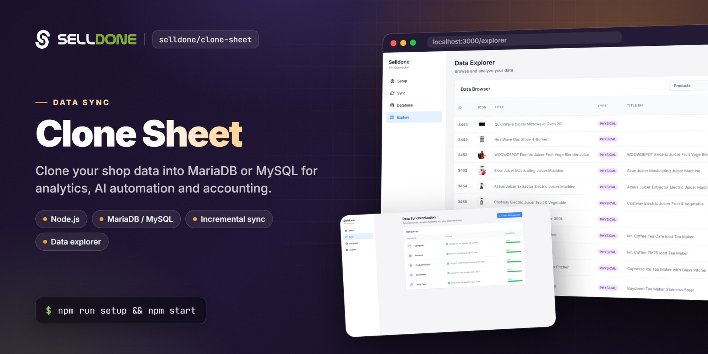
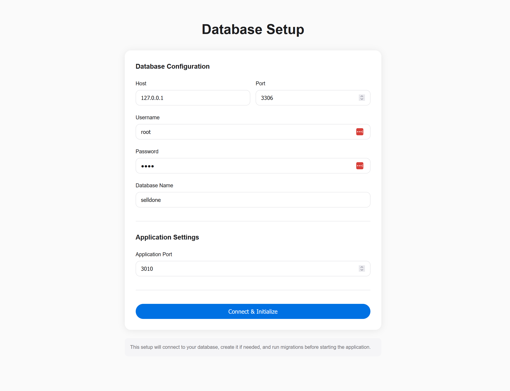
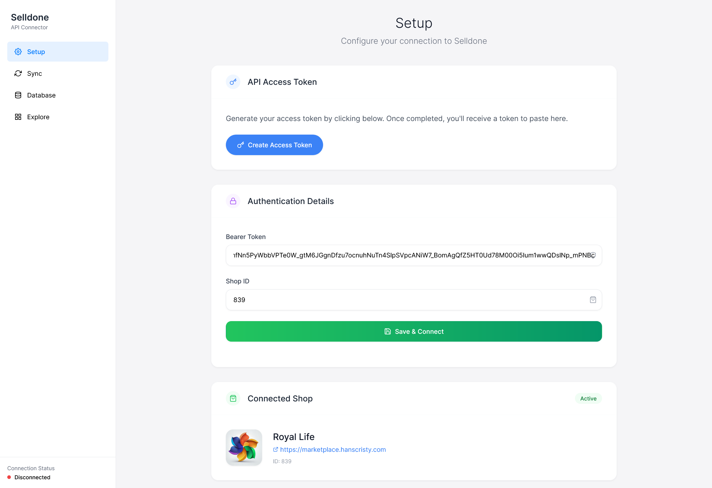
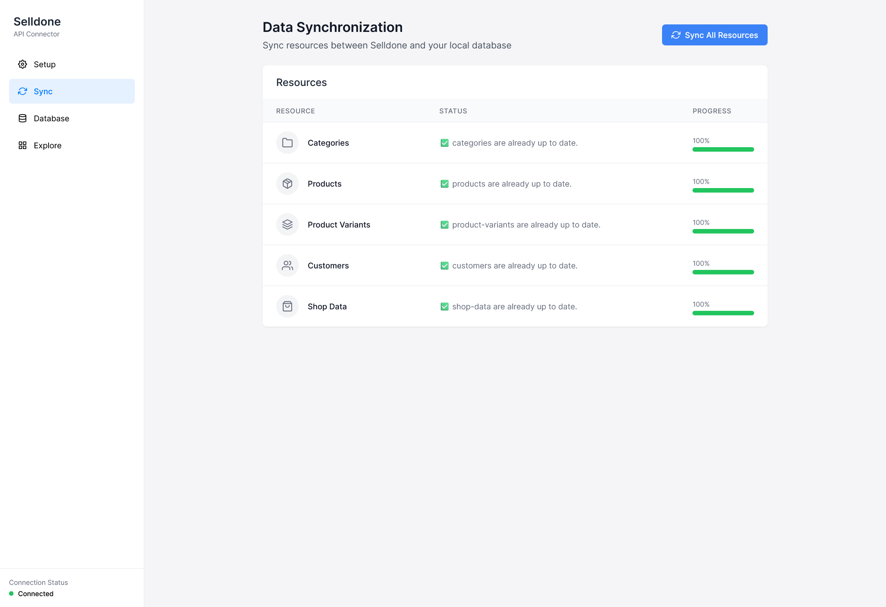
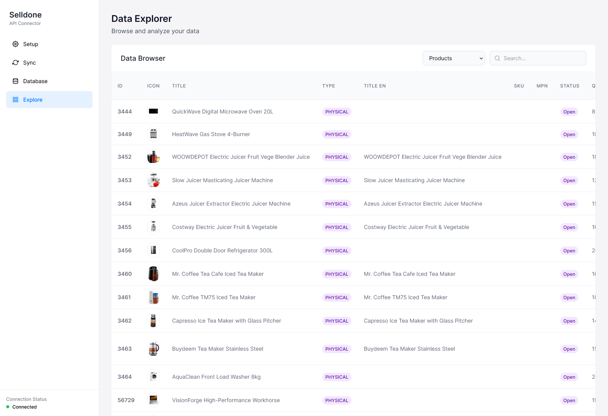
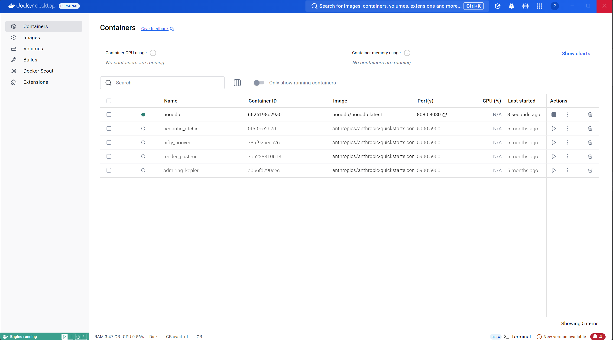
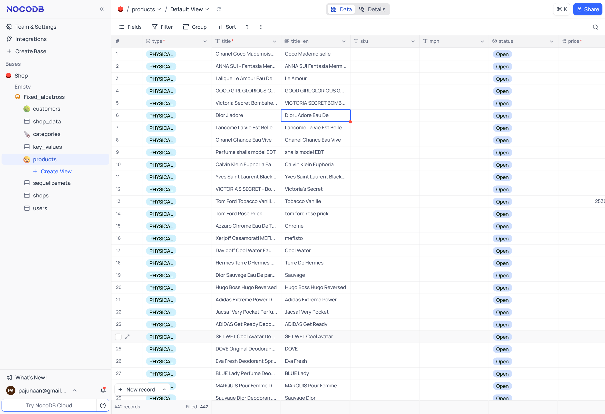

<p align="center">
  
</p>

<p align="center">
  <a href="https://www.npmjs.com/package/@selldone/clone-sheet"></a>
  <a href="https://www.npmjs.com/package/@selldone/clone-sheet"></a>
  <a href="https://github.com/selldone/clone-sheet/wiki"></a>
  <a href="https://selldone.com"></a>
</p>

<p align="center">
  <b>Clone your Selldone shop data into your own MariaDB or MySQL database for analytics, automation and integrations.</b><br>
  <a href="https://github.com/selldone/clone-sheet/wiki">Documentation</a> ·
  <a href="#quick-start">Quick start</a> ·
  <a href="https://github.com/selldone">Ecosystem</a> ·
  <a href="https://selldone.com">Selldone.com</a> ·
  <a href="https://github.com/selldone/clone-sheet/issues">Report an issue</a>
</p>

<p align="center">
  <a href="https://github.com/selldone/storefront">Storefront</a> ·
  <a href="https://github.com/selldone/pagebuilder">Page Builder</a> ·
  <a href="https://github.com/selldone/components">Components</a> ·
  <a href="https://github.com/selldone/storefront-sdk">Storefront SDK</a> ·
  <a href="https://github.com/selldone/backoffice-sdk">Backoffice SDK</a> ·
  <a href="https://github.com/selldone/vendor-sdk">Vendor SDK</a> ·
  <a href="https://github.com/selldone/community-sdk">Community SDK</a> ·
  <a href="https://github.com/selldone/core">Core</a> ·
  <a href="https://github.com/selldone/cli">CLI</a> ·
  <a href="https://github.com/selldone/translate">Translate</a>
</p>

## Overview

**Clone Sheet** lets you have your business data on your device. It creates a clone of your store's data from
**Selldone® Business OS** in an SQL database (MariaDB or MySQL) that you control. You can then use that data for AI
automation, accounting migrations, business analytics or integration with other software.

Clone Sheet is a small Node.js web app (Express, EJS and Sequelize) that runs on your machine. A setup wizard connects
it to your database and creates the tables. In the app, you paste a read-only Selldone access token and your shop ID,
then sync categories, products, variants, customers, shop statistics and orders with one click. Later syncs only fetch
records that changed.

Use Clone Sheet if you want SQL access to your shop data, for example to build dashboards in Power BI or Tableau, feed
an accounting system, or experiment with machine learning, without writing an API client first. The project is under
active development.

## Key features

- **Setup wizard** — `node setup.js` opens a browser form, creates the database if needed, writes `.env`, runs the migrations and starts the app.
- **MariaDB and MySQL** — works with either server, local or remote.
- **Token-based connection** — the **Create Access Token** button opens Selldone's token page with read-only scopes; you never enter your Selldone password in the app.
- **Seven resources** — categories, products, product variants, customers, shop data, baskets (orders) and basket items, plus your shop and user profile.
- **Incremental sync** — the last sync time of each resource is saved, so the next sync only fetches updated records.
- **Live progress** — records are fetched in batches of 100 with a progress bar per resource.
- **Data explorer** — browse any table with search, sorting, pagination and CSV export.
- **Ready for BI tools** — the Database tab shows connection details for tools such as NocoDB.
- **Safe shop switching** — connecting a different shop clears the previously synced data.

## Screenshots

| Setup wizard | Connect your shop |
|---|---|
|  |  |

| Sync data | Explore data |
|---|---|
|  |  |

## Quick start

**Requirements:** Node.js 14 or later, npm, and a running MariaDB or MySQL server
([download MariaDB](https://mariadb.org/download/?t=mariadb)).

```bash
git clone https://github.com/selldone/clone-sheet.git
cd clone-sheet
npm install
node setup.js        # or: npm run setup
```

1. Open the URL printed by the setup script (it starts on `http://localhost:3000`, or the next free port).
2. Enter your database host, port, username, password, database name and the application port, then click
   **Connect & Initialize**.
3. The app starts on `http://localhost:3010` (or the next free port) and opens automatically.
4. Click **Create Access Token**, select your shop on Selldone, copy the **Access Token** and **Shop ID** into the form
   and click **Save & Connect**.
5. Open **Sync** and click **Sync All Resources**.

Next time, start the app with `npm start`.

## Usage

### Step 1. Database setup

To use Clone Sheet, you need a MariaDB or MySQL database. You can install MariaDB on Windows, macOS, or Linux from the
[MariaDB download page](https://mariadb.org/download/?t=mariadb).

### Step 2. Clone the project

Clone the repository to your local machine using one of the following methods.

Using HTTPS:

```bash
git clone https://github.com/selldone/clone-sheet.git
cd clone-sheet
npm install
```

Using SSH:

```bash
git clone git@github.com:selldone/clone-sheet.git
cd clone-sheet
npm install
```

Using GitHub CLI:

```bash
gh repo clone selldone/clone-sheet
cd clone-sheet
npm install
```

Once cloned, you have the complete project files on your local machine with all dependencies installed.

### Step 3. Installation and setup

#### 1. Configure the database

Define the database host (local or remote). The setup process creates the database if it does not already exist and
updates the `.env` configuration file.

```bash
node setup.js
```


| Field | Default | Notes |
|---|---|---|
| Host | `127.0.0.1` | Database server host. |
| Port | `3306` | Database server port. |
| Username | `root` | |
| Password | `root` | |
| Database Name | `selldone` | Created with `CREATE DATABASE` if it does not exist. |
| Application Port | `3010` | Port for the Clone Sheet app. If it is busy, the next free port is used. |

When you click **Connect & Initialize**, the wizard tests the connection, creates the database if needed, writes
`.env` (`DB_HOST`, `DB_PORT`, `DB_USER`, `DB_PASSWORD`, `DB_NAME`, `PORT`) and `config/config.json`, runs
`npx sequelize-cli db:migrate` and starts the app.

#### 2. Start the server

The server runs on `http://localhost:3010` (the `PORT` value in `.env`) and gives you access to the cloned data.

```bash
npm start
```

### Using the app

The app has four tabs: **Setup**, **Sync**, **Database** and **Explore**.

#### 1. Create an access token

Click the **Create Access Token** button, which redirects you to Selldone. Select your shop, copy the **Access Token**
and **Shop ID**, and enter them in the form. Click **Save & Connect**.


The button opens `https://selldone.com/auth/erp` with these scopes: `selldone:identification`,
`backoffice:shop:read`, `backoffice:order:read`, `backoffice:product:read`, `backoffice:category:read` and
`backoffice:customer:read`. You can view and revoke tokens at
[selldone.com/developer/access](https://selldone.com/developer/access).

#### 2. Sync data

You can view the available data sources and their sync status. Click **Sync All Resources** to sync them one after
another; each resource shows its own status and progress bar.


| Resource | Local table |
|---|---|
| Categories | `categories` |
| Products | `products` |
| Product Variants | `product_variants` |
| Customers | `customers` |
| Shop Data | `shop_data` |
| Baskets (orders) | `baskets` |
| Basket Items | `basket_items` |

Your shop and user profile are saved to `shops` and `users` when you connect. Sync state and the token are kept in
`key_values`.

#### 3. Explore data

Access and explore the cloned data in the **Explore** tab: pick a table, search, sort by clicking a column header,
page through the results (20 rows per page) and export the current page as CSV.


The **Database** tab shows connection details for external tools and a **Clear All Data** action that empties the
synced tables.

### Visualizing data with NocoDB

To visualize the cloned data, you can use [NocoDB](https://www.nocodb.com/), an open-source database browser.

Set up NocoDB with Docker:

```bash
docker run -d \
  --name noco \
  -v "$(pwd)"/nocodb:/usr/app/data/ \
  -p 8080:8080 \
  nocodb/nocodb:latest
```



Open NocoDB in your browser at `http://localhost:8080`. Then set the SQL host to `host.docker.internal` and the port
to `3306` (or the correct port for your database).



Your store data is now cloned, and you can use it for automation, reporting or integrations.

### Why clone your data locally?

| Category | Use cases |
|---|---|
| **Advanced Analytics** | • Connect to Power BI, Tableau, or Google Data Studio for custom dashboards<br>• Execute complex SQL queries to uncover hidden business trends<br>• Perform cohort analysis and customer lifetime value calculations |
| **Custom Automation** | • Create sophisticated marketing campaigns based on purchase patterns<br>• Build personalized discount strategies for different customer segments<br>• Set up alerts and actions based on inventory or sales thresholds |
| **AI Integration** | • Train ML models on historical data to predict future sales trends<br>• Use MCP-compatible tools or OpenAI models to generate insights from business data<br>• Develop recommendation engines based on actual customer behavior |
| **System Integration** | • Connect seamlessly with QuickBooks, Xero or other accounting software<br>• Sync customer profiles with HubSpot, Salesforce or other CRMs<br>• Integrate with ERP systems for streamlined operations |
| **Data Sovereignty** | • Maintain complete control over your business information<br>• Keep secure, redundant backups of critical business data<br>• Implement custom security protocols for sensitive information |
| **Custom Reporting** | • Generate tailored reports for stakeholders and investors<br>• Schedule automated exports in various formats (PDF, Excel, CSV)<br>• Create visualizations focused on your specific KPIs |
| **Developer Flexibility** | • Build custom microservices around your business data<br>• Test new features without affecting production environment<br>• Develop mobile apps with customized data access layers |

### npm scripts

| Script | Command | Purpose |
|---|---|---|
| `npm run setup` | `node setup.js` | Run the setup wizard. |
| `npm start` | `node index.js` | Start the app. |
| `npm run dev` | `nodemon index.js` | Start the app and restart on file changes. |
| `npm run migrate` | `npx sequelize-cli db:migrate` | Apply database migrations. |
| `npm run create-db` | `node create-database.js` | Create the database named in `.env` if it does not exist. |
| `npm run lint` | `eslint .` | Lint the code. |

## Documentation

| Page | What you'll learn |
|---|---|
| [Home](https://github.com/selldone/clone-sheet/wiki) | What Clone Sheet does and how it works. |
| [Getting Started](https://github.com/selldone/clone-sheet/wiki/Getting-Started) | Install, set up the database and run your first sync. |
| [Setup and Configuration](https://github.com/selldone/clone-sheet/wiki/Setup-and-Configuration) | The setup wizard, `.env`, ports, migrations and npm scripts. |
| [Syncing Data](https://github.com/selldone/clone-sheet/wiki/Syncing-Data) | Tokens and scopes, resources, incremental sync and switching shops. |
| [Database Schema](https://github.com/selldone/clone-sheet/wiki/Database-Schema) | The tables and their main columns. |
| [Exploring and Visualizing](https://github.com/selldone/clone-sheet/wiki/Exploring-and-Visualizing) | The Explore and Database tabs, CSV export, NocoDB and BI tools. |
| [FAQ](https://github.com/selldone/clone-sheet/wiki/FAQ) | Common questions and troubleshooting. |

## How it fits in the ecosystem

Clone Sheet reads your shop through the Selldone shop-admin API with the same per-shop token flow used by the
[ERP integration guide](https://github.com/selldone/erp). It is the opposite direction of the
[Excel templates](https://github.com/selldone/excel): Excel loads data into a shop, Clone Sheet copies it out to your
own database.

<a href="https://github.com/selldone#ecosystem">
  
</a>

### Related projects

| Project | Why it matters here |
|---|---|
| [ERP](https://github.com/selldone/erp) | Guide and demos to connect ERP software to Selldone shops; documents the token link and order fields. |
| [Excel](https://github.com/selldone/excel) | Excel templates for bulk import. |
| [Backoffice SDK](https://github.com/selldone/backoffice-sdk) | Admin API client for custom dashboards and integrations. |
| [Core](https://github.com/selldone/core) | Shared models, types, enums and helpers. |
| [GPT](https://github.com/selldone/gpt) | Schema and guide to build a custom GPT for Selldone. |

## Contributing

Contributions are welcome. Please read the organization
[contributing guide](https://github.com/selldone/.github/blob/main/CONTRIBUTING.md) and
[code of conduct](https://github.com/selldone/.github/blob/main/CODE_OF_CONDUCT.md).

Development notes (from [DEV.md](DEV.md)):

```bash
# Create a migration
npx sequelize-cli migration:generate --name create-products

# Create a migration and a model
npx sequelize-cli model:generate --name Product --attributes title:string,price:float

# Create the database and migrate
node create-database.js
npx sequelize-cli db:migrate

# Run
node index.js
```

To add a new resource, add a model and migration, a route that uses `src/utils/ResourceSync.js`, and an entry in
`src/TableConfig.js`.

## Security

Please do not report security vulnerabilities in public issues. Follow the
[Selldone security policy](https://github.com/selldone/.github/blob/main/SECURITY.md) and email
[security@selldone.com](mailto:security@selldone.com).

Clone Sheet has no login of its own, and the access token is stored in the `key_values` table of your database. Run
it on a trusted machine, do not expose its port to the internet, and protect the database like any other copy of
your business data.

## License

This repository does not currently include a license file. For questions about usage terms, contact
[info@selldone.com](mailto:info@selldone.com).

---
<p align="center"><sub>Part of the <a href="https://github.com/selldone">Selldone® Business OS</a> open-source ecosystem · <a href="https://selldone.com">selldone.com</a></sub></p>
